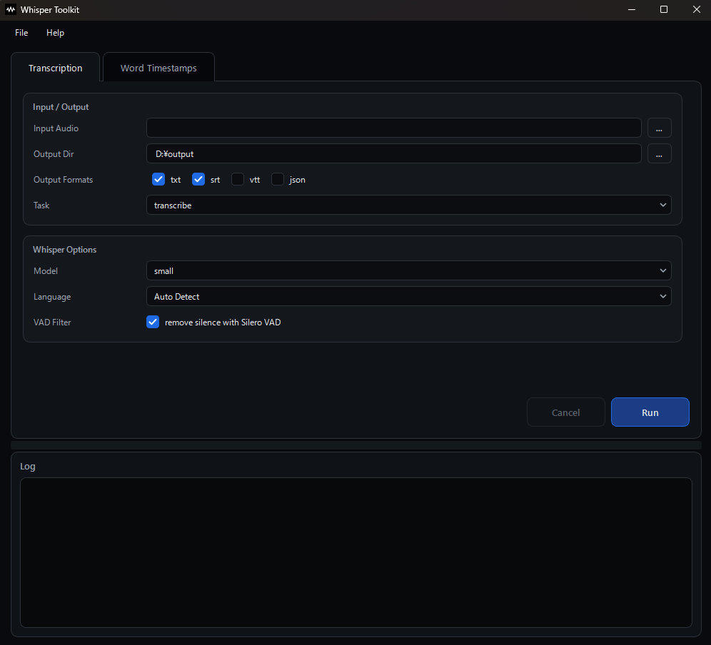
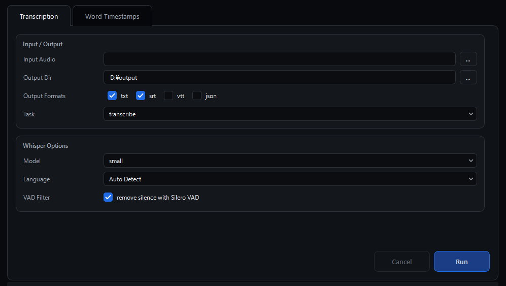
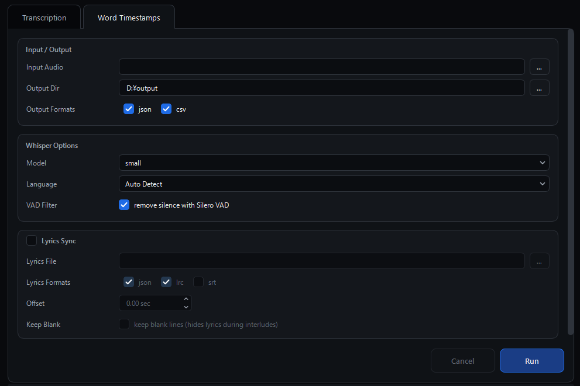

<a href="/README.ja.md">日本語版ドキュメントはこちら</a>

# Whisper Toolkit


**A tool that makes OpenAI's speech recognition model Whisper usable from a GUI.** (Windows / macOS)

Instead of the original `openai-whisper`, this tool runs on **[faster-whisper](https://github.com/SYSTRAN/faster-whisper)**.  
It is an optimized reimplementation of the same models: roughly **4x faster even on CPU**, and it **does not require a separate ffmpeg installation**.

| What it does                                                                                               | Output                             |
| ---------------------------------------------------------------------------------------------------------- | ---------------------------------- |
| **Transcription** — write out full text and subtitles from audio/video                                     | `.txt` / `.srt` / `.vtt` / `.json` |
| **Word timestamps** — write out per-word start/end times and confidence                                    | `.json` / `.csv`                   |
| **Lyrics sync** — re-apply the **correct lyrics text** onto the word timestamps to build karaoke subtitles | `.json` / `.lrc` / `.srt`          |



---

## 1. Requirements

| Item   | Details                                                                                                                                          |
| ------ | ------------------------------------------------------------------------------------------------------------------------------------------------ |
| OS     | Windows 10 / 11, macOS (the mac scripts also work as-is on Linux)                                                                                |
| Python | **Pinned to 3.13** (→ [docs/development/python_version.md](docs/development/python_version.md))                                                  |
| Disk   | About 1–5 GB for the models (roughly 0.5 GB for `small`, 3 GB for `large-v3`)                                                                    |
| GPU    | Optional. An NVIDIA GPU with CUDA 12 speeds things up a lot (it still runs on CPU without one). **macOS has no CUDA support, so it runs on CPU** |

---

## 2. Setup

Create a virtual environment and install the dependencies.

**Windows** (you can also just double-click the bat file)

```bat
scripts\win\setup_venv.bat
```

To use a GPU (CUDA 12), pass the `gpu` argument and cuBLAS / cuDNN will be installed as well.

```bat
scripts\win\setup_venv.bat gpu
```

**macOS / Linux**

```sh
./scripts/mac/setup_venv.sh
```

If it will not run, execute `chmod +x scripts/mac/setup_venv.sh` once.

Both scripts look for Python 3.13, create `.venv`, and install
`requirements.txt` (faster-whisper and PySide6).

> To do it manually: `py -3.13 -m venv .venv` →
> `.venv\Scripts\activate` → `pip install -r requirements.txt`.

---

## 3. Usage

### Launching

**Windows** (you can also just double-click the bat file)

```bat
scripts\win\LaunchApp.bat
```

**macOS / Linux**

```sh
./scripts/mac/LaunchApp.sh
```

The window has two rows: input tabs on top, the log below.

### Preparing audio

Put audio files (wav / mp3 / m4a / mp4, etc.) in the `input\audio\` folder and the file dialog will open there first.  
If you do not have a file at hand, record one with the Windows "Sound Recorder" or generate one with the built-in speech synthesizer.

```powershell
Add-Type -AssemblyName System.Speech
$s = New-Object System.Speech.Synthesis.SpeechSynthesizer
$s.SetOutputToWaveFile("$PWD\input\audio\sample.wav")
$s.Speak("Hello. This is a Whisper sample for speech recognition.")
$s.Dispose()
```

On macOS, `say -o input/audio/sample.aiff "..."` does the same.  
Whisper converts the audio to 16 kHz mono internally, so converting it yourself is not required.

### Transcription tab — transcribing

**Writes out full text and subtitles from audio/video.**

Pick the audio in `Input Audio`, change the options if needed, and press `Run`.



#### Input / Output

| Item           | Default      | Description                                                                                      |
| -------------- | ------------ | ------------------------------------------------------------------------------------------------ |
| Input Audio    | not set      | The input audio/video file. Press `...` to pick one from `input/audio/`                          |
| Output Dir     | `output/`    | Where the results are written                                                                    |
| Output Formats | `txt`, `srt` | Choose from `txt` / `srt` / `vtt` / `json`. Clearing all of them writes no files                 |
| Task           | `transcribe` | `transcribe` keeps the original language; `translate` transcribes while translating into English |

#### Whisper Options

| Item       | Default       | Description                                                                                      |
| ---------- | ------------- | ------------------------------------------------------------------------------------------------ |
| Model      | `small`       | The Whisper model to use. Larger models are more accurate but take more time and memory          |
| Language   | `Auto Detect` | The language of the audio. Specifying it is faster and more accurate when you know it            |
| VAD Filter | ON            | Removes silent parts with Silero VAD. Try turning it OFF if the later part of a song breaks down |

Files such as `output\<filename>.transcribe.txt` are written.

### Word Timestamps tab — word-level timing + lyrics re-application

**Writes out per-word start/end times and confidence.**  
It optionally bundles a feature that **re-applies the correct lyrics text to build karaoke subtitles**.

Pick the audio in `Input Audio`, change the options if needed, and press `Run`.



#### Input / Output

| Item           | Default       | Description                                                             |
| -------------- | ------------- | ----------------------------------------------------------------------- |
| Input Audio    | not set       | The input audio/video file. Press `...` to pick one from `input/audio/` |
| Output Dir     | `output/`     | Where the results are written                                           |
| Output Formats | `json`, `csv` | The formats used to write per-word start time, end time, and confidence |

#### Whisper Options

| Item       | Default       | Description                                             |
| ---------- | ------------- | ------------------------------------------------------- |
| Model      | `small`       | The Whisper model to use                                |
| Language   | `Auto Detect` | The language of the audio. Specifying it is recommended |
| VAD Filter | ON            | Removes silent parts with Silero VAD                    |

#### Lyrics Sync

| Item           | Default       | Description                                                                            |
| -------------- | ------------- | -------------------------------------------------------------------------------------- |
| Lyrics Sync    | OFF           | When ON, the lyrics are re-applied after the word timestamps are obtained              |
| Lyrics File    | not set       | The correct lyrics text. UTF-8, one phrase per line                                    |
| Lyrics Formats | `json`, `lrc` | Output formats for the re-applied lyrics. Choose from `json` / `lrc` / `srt`           |
| Offset         | `0.00 sec`    | Seconds added to every output time. A negative value shows the lyrics earlier          |
| Keep Blank     | OFF           | Keeps blank lines in the lyrics. Use it to clear the lyrics during instrumental breaks |

Normally `output\<filename>.words.json` / `.words.csv` are written.

If you check **Lyrics Sync** and select a lyrics text, the post-processing step that "re-applies the correct lyrics on top of the recognized timings" runs as well, and a karaoke subtitle `.lrc` is written.  
The end of the log shows the **match rate and the "recognized → lyrics" diff**, so you can confirm that only the characters were corrected while the timings stayed the same.

The lyrics file must be **UTF-8 with one phrase per line**.  
Blank lines, lines starting with `#`, and heading lines such as `【1番】` are skipped automatically.

### While it is running

- Inference runs on a separate thread, so the window does not freeze while it works
- `Cancel` stops **once the next segment/word has been finalized**
- If the selected model is not available locally, a download confirmation dialog appears before the run
  (the first time can take a few minutes)
- The output folder opens when it finishes
- The window position/size and the input values are saved on exit and restored on the next launch
- `File > Clear Saved Settings...` clears the saved values and resets the screen to the defaults
- `Help > Open Document` opens the project's GitHub page

See **[docs/gui/usage.md](docs/gui/usage.md)** for the details of each option.

---

## 4. Folder structure

```
python-whisper-sample/
├─ python/
│   └─ wsptoolkit/       package bundling the GUI, CLI, and processing
│       ├─ main.py           ← entry point. launched with -m wsptoolkit.main
│       ├─ tool_config.py    title, size, and resource paths
│       ├─ definitions.py    the choices shown in the GUI (model, language, task)
│       ├─ logger.py         streams the log to the screen
│       ├─ task_runner.py    runs inference on a separate thread
│       ├─ gui/              Model / View / Controller and the screen widgets
│       ├─ cli/              three CLI modules and their shared code
│       └─ lib/              the processing shared by the CLI and GUI
│           ├─ data/             the data classes passed around
│           ├─ whisper/          Whisper inference
│           ├─ lyrics/           lyrics matching (independent of Whisper)
│           └─ paths.py / settings.py / timecode.py
├─ resources/          icons and the stylesheet
├─ build_env/          the PyInstaller build environment
├─ docs/               detailed documentation
├─ input/              inputs (the contents are .gitignore'd)
│   ├─ audio/            put audio files here
│   └─ lyrics/           put lyrics text here
├─ output/             the written results
├─ scripts/
│   ├─ win/setup_venv.bat / LaunchApp.bat
│   └─ mac/setup_venv.sh  / LaunchApp.sh
├─ .python-version     the Python version to use (3.13)
├─ requirements.txt
└─ pyproject.toml      the Ruff configuration
```

All Python code lives under `python/wsptoolkit/`.  
The processing modules neither print to the screen nor exit the process (progress goes through `logging`, failures are exceptions), so the CLI and the GUI can call the very same API.

The default input/output paths are resolved **relative to the repository root rather than the current directory**, so the results are written to the same place (`output/`) no matter where you run it from.

---

## 5. Running from the CLI

The same processing as the GUI can be run from the command line.  
Activate the virtual environment first (`.venv\Scripts\activate` on Windows, `source .venv/bin/activate` on mac).  
As with Command Launcher, only `<root>/python` is added to the search path.

```bat
REM Windows (run at the repository root)
set PYTHONPATH=%CD%\python
```

```sh
# macOS / Linux (run at the repository root)
export PYTHONPATH="$PWD/python"
```

```bat
REM (1) Transcription
python -m wsptoolkit.cli.transcribe input\audio\sample.mp3 --model medium --language ja
python -m wsptoolkit.cli.transcribe input\audio\sample.mp3 --formats txt,srt,vtt,json

REM (2) Word timestamps
python -m wsptoolkit.cli.word_timestamps input\audio\sample.mp3 --language ja
python -m wsptoolkit.cli.word_timestamps input\audio\song.wav -l ja -m large-v3 --no-vad

REM (3) Lyrics sync (uses the JSON from (2))
python -m wsptoolkit.cli.sync_lyrics song.words.json --lyrics input\lyrics\song.txt
python -m wsptoolkit.cli.sync_lyrics song.words.json --lyrics input\lyrics\song.txt --offset -0.3
```

Every option the GUI does not expose (`--device` / `--compute-type` / `--beam-size` / `--initial-prompt`, word filtering, repetition-breakdown countermeasures, and so on) is available on the CLI side.  
Run `-h` to see all of them.

- [docs/cli/common_options.md](docs/cli/common_options.md) — common options
- [docs/cli/transcribe.md](docs/cli/transcribe.md) — (1) transcription
- [docs/cli/word_timestamps.md](docs/cli/word_timestamps.md) — (2) word timestamps
- [docs/cli/sync_lyrics.md](docs/cli/sync_lyrics.md) — (3) lyrics sync

---

## 6. Documentation

The detailed specifications, options, and implementation notes live in [docs/](docs/README.md).

|                                                                      |                                                        |
| -------------------------------------------------------------------- | ------------------------------------------------------ |
| [docs/gui/usage.md](docs/gui/usage.md)                               | all GUI options                                        |
| [docs/guide/models.md](docs/guide/models.md)                         | choosing a model size                                  |
| [docs/guide/gpu.md](docs/guide/gpu.md)                               | running on a GPU (CUDA)                                |
| [docs/guide/word_timestamps_ja.md](docs/guide/word_timestamps_ja.md) | Japanese caveats, and what to do when long songs break |
| [docs/guide/troubleshooting.md](docs/guide/troubleshooting.md)       | troubleshooting                                        |
| [docs/development/architecture.md](docs/development/architecture.md) | the overall structure and the MVC setup                |
| [docs/development/build.md](docs/development/build.md)               | building an exe / app with PyInstaller                 |
| [docs/instructions/code_guide.md](docs/instructions/code_guide.md)   | coding rules                                           |

---
